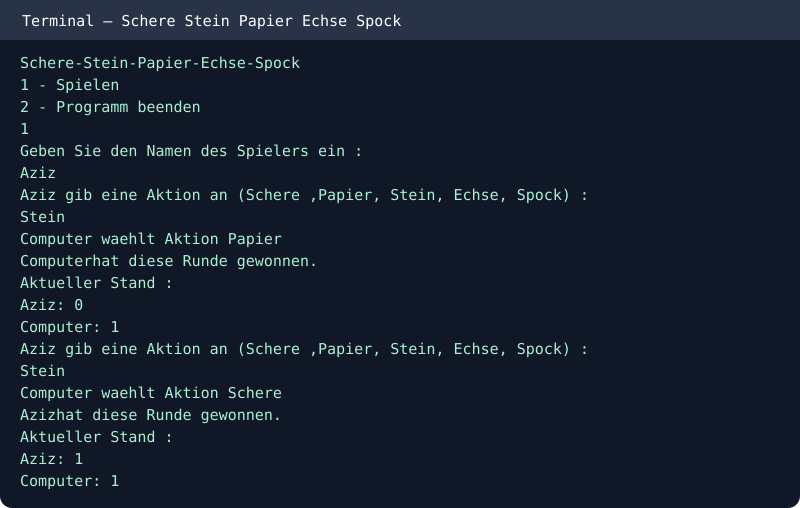

# Rock Paper Scissors Lizard Spock — Java
Interactive terminal game against a random computer opponent. The first player to win three rounds wins.

## Run
```bash
javac -d out src/*.java
java -cp out Spiel
```

Choose **1** to play, enter your name and one of: `Schere`, `Stein`, `Papier`, `Echse`, `Spock`. Select **2** to quit.

## Features
- Five actions with cyclic win logic
- Computer chooses randomly
- Input validation
- Round scores and match winner

## Console example


Java student project.